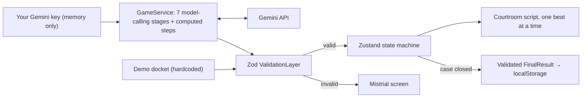
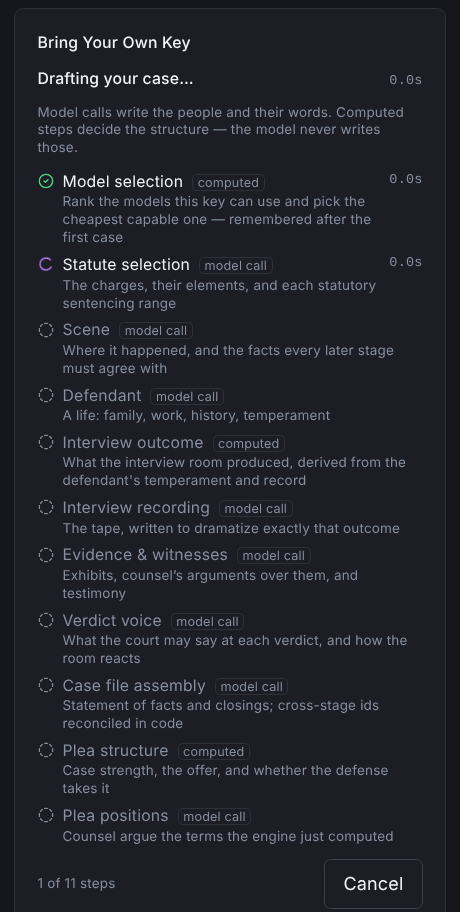
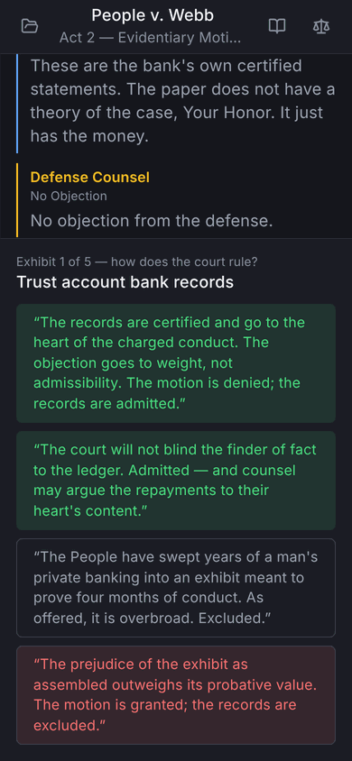

# The Bench

[](https://github.com/jcrump97/the-bench/actions/workflows/verify.yml)
[](./LICENSE)

**You are the judge.** A California criminal case unfolds in front of you one statement at a time, and you rule on the plea, the evidence, the verdict and the sentence.

**▶ Play it: [jcrump97.github.io/the-bench](https://jcrump97.github.io/the-bench/)** — no sign-up and no API key needed, on a desktop or a phone. Five demo cases are ready on the docket; *People v. Eli Navarro* is the guided tutorial.


Bring your own Gemini API key and the game writes you a new case instead. It runs entirely in the browser: a static site with no backend, where a non-deterministic model is forced through a deterministic state machine by strict schemas and Zod validation.

## Who It's For

One courtroom, written to hold up for three very different players:

| If you are… | Look for |
|---|---|
| **An attorney** | Procedure that follows a California criminal courtroom — arraignment, discovery, a §1192.5 plea the court may refuse, Miranda and voluntariness fights over a recorded interview, allocution under §1200, a sentence chosen inside the statutory range. The **Bench Book** cites the authority behind each term and lists, plainly, where the game simplifies the law. |
| **An AI architect** | A non-deterministic model forced through a deterministic state machine. Start a case with your own Gemini key and the generating screen draws the pipeline as it runs — which steps are model calls, which are computed and never generated. Then read on below. |
| **A high-school student** | The **guided tutorial case** (marked *Start here*), a title card at each act saying what you're deciding, and the Bench Book's plain-English definitions for every term the courtroom throws at you. |

## Why This Exists

This is my first portfolio project as I transition from the Service Desk to AI Systems Architecture. I chose to do this because I have always had an interest in the criminal legal system. This project was born from countless hours of listening to actual court proceedings, researching different perspectives of the legal system, brainstorming with family/friends and AI, as well as a desire to take a complex system and to create some form of it while demonstrating the skills I have been learning over the past couple of years. I am building it in public with Claude, with an abundance of thought, planning, consideration, and passion injected as well. The commit history is the real documentation of the process. I believe the best results come from collaborating with AI, leaving the decisions to the human, not the AI.

## What I Learned

- **Don't try to perfect the schemas before testing them live.** I spent the early phase trying to get the schemas right on paper, but some things only show up against the real API: Gemini rejected a schema that looked perfectly valid, sent `null` where my code expected a missing field, and kept getting a score wrong until the 1–10 range was actually stated to it. Now I plan enough to start, test live, and let the results drive the changes.
- **The AI drafts, but I own the design.** Early on, especially while planning the schemas, the AI kept being sloppy, leaving out details that would be critical later in the game. Its first sentence schema would have accepted a fine measured in years, or community service paid in dollars. I pushed back and made every sentence type carry only the units that make sense for it, and everything from the plea offer to the release date is built on that rule.
- **Some of the design came from the service desk.** I especially wanted the side panels to peek out when a case opens, so players see immediately that they can interact with those buttons and expand the panels.

## Architecture

The LLM provides color; deterministic code provides structure. The model
writes the people and their words. Plea structure, sentencing ranges, what the
interview room produced and how hard a sentence landed are pure functions of
validated data, and every payload, generated or hand-authored, crosses the
same Zod gate before the game can use it.





*The generating screen with your own key: model calls write the people and their words, computed steps decide the structure.*

**[Read the full architecture →](./docs/ARCHITECTURE.md)** Three diagrams
(trust boundaries, the generation pipeline, the courtroom) with what each
derivation decides.

## Status



**Version 1.0: feature-complete and playable end to end, with no key or with your own.**

- **The demo docket** — five hand-authored cases, every branch reachable: **People v. Eli Navarro** (the guided tutorial), **People v. Marcus Webb** (MODERATE offer), **People v. Curtis Boone** (WEAK, no offer), **People v. Dominic Reyes** (STRONG, offer rejected) and **People v. Teresa Vaughn** (multi-charge, a verdict on each count).
- **The courtroom** — arraignment and discovery before the plea; the record unfolding one statement at a time; exhibits offered, argued and ruled on individually, with recorded interrogations played line by line before the suppression fight; direct and cross; closings that answer to your rulings; per-count verdicts; allocution on the plea path; a sentence chosen inside the statutory range.
- **The close** — a minute order filed under the record that reads the sentence back as consequence, an aftermath that answers *how hard* the sentence landed and not just the verdict, and a bench record that follows the judge across cases.
- **Generated cases** — a seven-stage Gemini pipeline behind your own key, drawn live on the generating screen, cancellable, and loaded only for players who use it.
- **Orientation** — act title cards, the guided tutorial, and the Bench Book (plain-English terms, California authority, an honest list of simplifications, and what code decides versus what the model writes).
- **Mobile friendly** — the same courtroom at phone width: the case-file panels fold away behind the top bar, and every ruling is a full-width tap target. The trial path is tested end to end at 375 px in CI.
- **Quality gates** — lint, 588 unit tests, the type-negative build, and an eight-run Playwright suite against the production bundle run in CI on every pull request; the deploy publishes only the artifact the end-to-end suite passed against.

**Open, and deliberately left to the author** (see [`TODO.md`](./TODO.md)): a per-count custody election for wobblers (S1), a unit-safe sentencing floor (S2), whether an off-phase store write should vacate the game or reject only the write (A7), and showing the player how many calls a generated case spent (A5).

**How it got here**, in brief: the schemas, state machine and demo docket came first; then the beat-by-beat courtroom; then the BYOK generation pipeline, made reliable by measuring it against the live API rather than guessing; then the close of the case (the minute order, the aftermath, a bench record across cases); and finally the road to 1.0, which made the game readable for its three audiences. The full story is in **[docs/HISTORY.md](./docs/HISTORY.md)**.

## Run It Locally

Needs Node 22 (pinned in `.nvmrc`).

```bash
npm ci
npm run dev        # http://localhost:5173/the-bench/
```

The demo docket needs nothing else. To generate a case, paste a
[Gemini API key](https://aistudio.google.com/apikey) into the
*Bring Your Own Key* form: it is held in memory only, never written to storage,
and sent to Google in a request header, never in a URL.

## Testing

Four gates run in CI on every pull request and every push to `main`, and the
deploy publishes only the artifact the end-to-end suite passed against.

```bash
npm run lint       # ESLint — no-explicit-any, ban-ts-comment, no-console
npm test           # Vitest — hermetic, never calls the Gemini API
npm run build      # tsc -b (enforces the @ts-expect-error gates) + vite build
npm run test:e2e   # Playwright — the whole demo docket, headless, no API key needed
```

The end-to-end suite plays all five demo cases, across both the plea and trial
paths and at desktop and phone widths, and drives the BYOK generating screen with every
Gemini request answered inside the browser, so it needs no key and spends no
quota. What each run asserts is in the
[`run-the-bench` skill](./.claude/skills/run-the-bench/SKILL.md).

Two further checks are **manual only**. Both call the real Gemini API and spend
real quota, and neither is wired into CI:

```bash
npm run test:live                             # live pipeline suite, every response schema, 5-run sweep
node .claude/skills/qa-agent/qa-agent.mjs     # LLM-as-judge playthrough of a generated case
```

`test:live` validates the pipeline against the actual API and has found four
bugs the mocked suite could not. `qa-agent` is the only check that reads what
the pipeline *writes*: it plays a live case and has an independent Gemini call
judge every beat for realism, the way a human tester would.

## Tech Stack

- Vite 8 + React 19 + TypeScript 6 (strict)
- Zustand 5 (state management)
- Zod 4 (validation gatekeeper, and the source the Gemini response schemas are compiled from)
- Tailwind CSS 4 + lucide-react (presentation layer only)
- Vitest (unit tests) and Playwright (end-to-end, installed outside the project)
- GitHub Pages (static hosting)

## License

MIT
