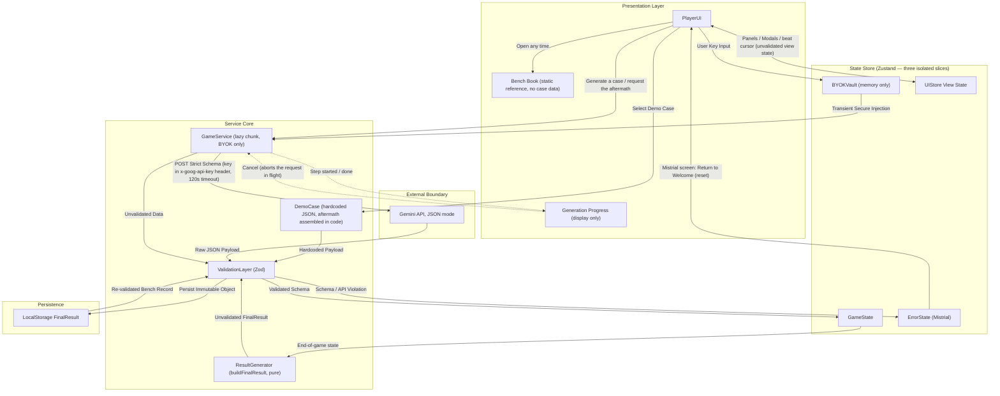
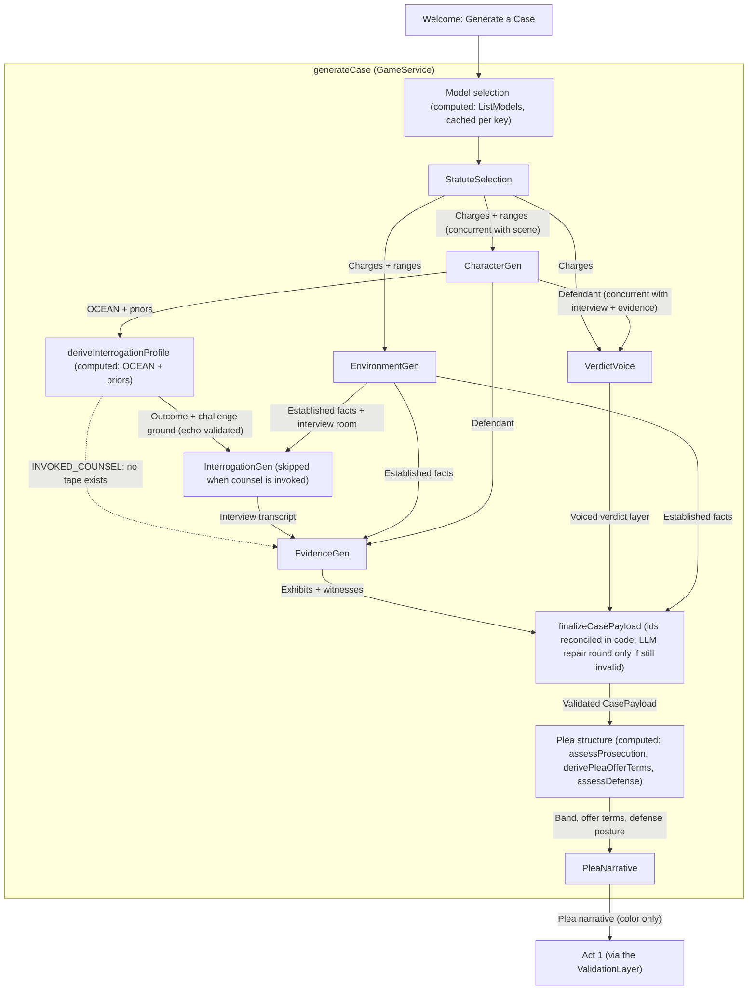
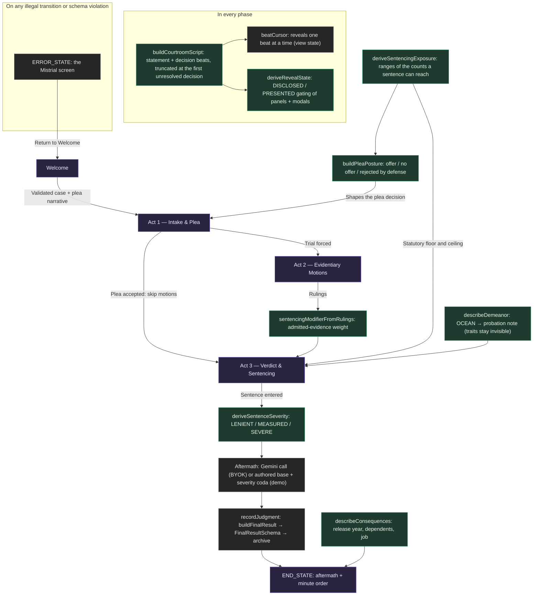

# Architecture

How The Bench forces a non-deterministic model through a deterministic state
machine. The [README](../README.md#architecture) has the one-screen summary;
this page has the detail. Three diagrams, each answering one question:

1. [Trust boundaries & data flow](#trust-boundaries--data-flow) — where data
   comes from, and which gate it must pass before the game can use it.
2. [The generation pipeline](#the-generation-pipeline) — how a BYOK case is
   written, and which steps are model calls versus computed.
3. [The courtroom](#the-courtroom) — how the phases run, what each derivation
   decides, and how a case closes.

`CLAUDE.md` is the full engineering reference; the diagrams here are checked
against the code (`src/lib/llm/gameService.ts`, `src/store/`, `src/lib/`).

## Trust Boundaries & Data Flow

Every payload, from the model, from the hardcoded demo docket, or read back
out of localStorage, crosses the same Zod gate before it reaches game state.
A failure at that gate forces `ERROR_STATE` (the Mistrial screen), whose only
way out is back to the docket.

## The Generation Pipeline

Seven model-calling stages, with four computed steps between them. Two pairs
share no inputs and run concurrently, so the critical path is five round trips
rather than seven. The generating screen draws exactly these steps as they
run. Every model response is validated against the same Zod schemas the demo
docket crosses, and a failure is retried with the issues and the previous
response fed back as a repair task.

`EnvironmentGen`'s `establishedFacts` are the shared scene contract: the
interview, the evidence and the final assembly are all handed them verbatim,
so no later stage re-derives the scene and drifts from it.

## The Courtroom

The phases run in one direction only, and every illegal transition forces
`ERROR_STATE`. Everything in the middle column is a pure function of validated
data: the model never decides structure. Green boxes are those derivations;
purple boxes are phases.

The LLM provides color; deterministic code provides structure. Plea structure, case-level sentencing exposure, and the Act 2 → Act 3 penalty modifier are all pure functions of validated data — the LLM's only plea contribution is narrative strings (rationales, arguments, testimony, allocution). Exposure aggregates the statutory ranges of the counts a sentence can actually reach: every count on the plea path, but only the counts of conviction after a trial, so an acquitted count's range can't reshape the sentence for the counts that were proven. Where a case mixes prison-eligible and jail-only counts, the exposure collapses to one custody type rather than narrating both as separately imposed — counts sentenced together aggregate into a single commitment (Cal. Penal Code §669).

The judge's most discretionary act is choosing the number inside the range, so
the close reads it back: `deriveSentenceSeverity` places the term between the
lightest sentence the court could actually impose and the statutory ceiling.
The demo docket appends one authored coda per band to its aftermath; the BYOK
aftermath prompt is given the range, the severity reading, the refused offer,
the excluded exhibits and the household. The minute order, from
`describeConsequences`, reads the term back as consequence: release year and
age, dependents, the job it ends.

The case plays out **one beat at a time**: `buildCourtroomScript` projects validated state into an ordered screenplay of speaker-attributed statements and decision points, truncated at the first unresolved decision (no spoilers) and prefix-stable (resolving a decision never rewrites the past). A reveal cursor in the view-state slice paces the courtroom — the prosecutor offers each exhibit, the defense objects or waives, witnesses testify, and the judge rules from the bench at every pause. The judge's rulings are *voiced*: each decision point presents authored bench lines bound to the closed decision enums (variants multiply voice, never the state space), the chosen words enter the record verbatim, and the courtroom reacts in character to every ruling. The record itself reads as a spoken transcript — every line led by the party speaking (witnesses and the allocuting defendant by name), each party in its own accent, with the court's rulings and the press aftermath set apart from the flowing testimony. Even the closing arguments answer to what happened: each side's per-exhibit points are assembled onto its closing according to the ruling the judge actually entered, so neither counsel can argue the merits of an exhibit the court suppressed.

Act 1 follows real procedure: the clerk performs only the call and the charges, the defense enters the not-guilty plea, the People state the facts, and both sides disclose their exhibits and witnesses before any plea offer lands. What the judge can browse follows the record — the panels and detail modals are gated by a derived reveal state (`DISCLOSED` at discovery with counsel's brief unverified summary, `PRESENTED` with full detail once the item is offered or the witness sworn), and any transcript line that presents an item clicks through to its detail view. Police interrogations are *simulated at generation time*: a pure function of the defendant's OCEAN traits and priors decides what the interview room produced (confession, partial admission, denial, or lawyering up — in which case no tape exists) and which ground the defense attacks it on; the authored transcript dramatizes exactly that structure, and the tape is played into the record line by line before the suppression ruling. The traits themselves are never displayed — at sentencing the judge reads a derived probation demeanor note instead.
